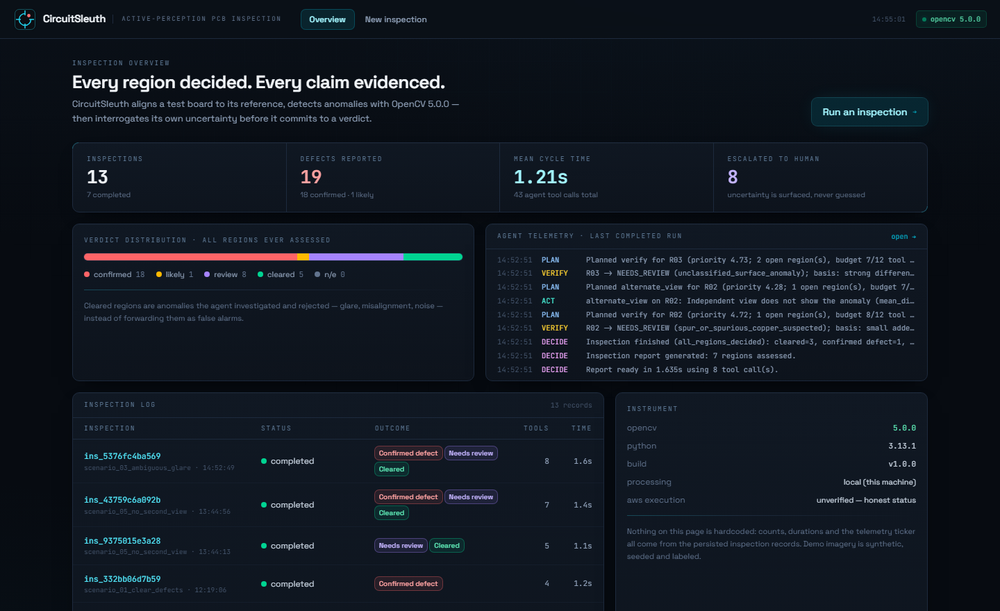
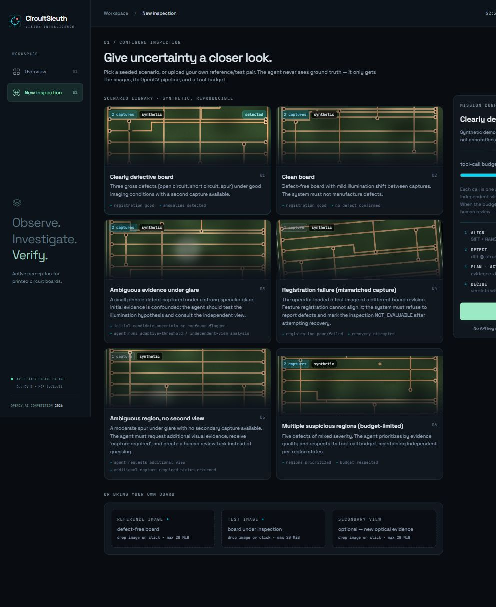
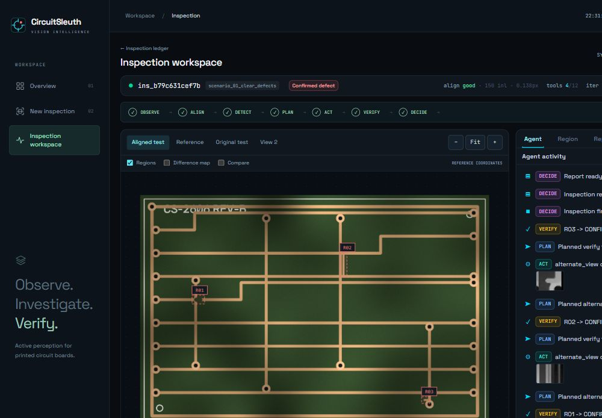

<p align="center">
  
</p>

<h1 align="center">CircuitSleuth</h1>

<p align="center">
  <b>See deeper. Inspect smarter. Verify before deciding.</b><br/>
  An active-perception PCB inspection agent — OpenCV 5 finds what changed,
  the agent decides what to look at next, and every verdict carries its evidence.
</p>

<p align="center">
  
  
  
  
  
</p>

---

**Team Update — Shikhar Goel and Ishpreet Singh.**

**CircuitSleuth** is being prepared for the [OpenCV AI Competition 2026](https://opencv26.devpost.com/) (Agentic Vision Award track).
Conventional AOI pipelines run a fixed sequence on a fixed image — they cannot change their mind, ask for
more evidence, or refuse to answer. CircuitSleuth is an **agent**: it aligns the test board to a reference,
detects anomalies, measures its own uncertainty, then selects follow-up tools per region (illumination
confound tests, independent-view comparisons, edge topology, local re-registration) until each finding is
**confirmed, cleared, escalated — never guessed**.

| Dashboard | New inspection |
|---|---|
|  |  |

<p align="center">
  
  <br/>
  <sub>The live workspace: board viewer with verdict-coded regions, the agent's real PLAN → ACT → VERIFY
  feed with artifact thumbnails, per-region evidence trails, and the operator review loop.</sub>
</p>

## Why it's genuinely agentic

- **The plan is never scripted.** A documented priority score re-ranks every (region, tool) pair from
  current measurements after each result — see `backend/app/agent/policy.py`. The sequence you watch in
  the UI *emerges*; it is not hardcoded per demo.
- **Bounded and honest.** Tool-call budget, stop conditions, and escalation: when evidence is
  inconclusive and no second capture exists, the agent formally requests a new capture
  (`additional_capture_required`) and creates a human-review task. You can upload the capture in the UI
  and **re-run the same inspection with the added evidence** — the operator loop closes.
- **One toolbelt, two doors.** The same eight tools the orchestrator calls internally are exposed over a
  real **MCP server** (official SDK, stdio). Any MCP client can drive a persisted inspection.
  See [`docs/MCP.md`](docs/MCP.md) and [`mcp_config.example.json`](mcp_config.example.json).

## The OpenCV 5 core — and how it was hardened

OpenCV **5.0.0** (verified at runtime via `/api/health`; never silently downgraded):

- **Registration** — SIFT/ORB mutual + ratio matching, multiple RANSAC hypotheses **verified
  photometrically**, ECC refinement **accepted only if it doesn't degrade agreement**, quality gates that
  include frame coverage. This mattered: on periodic layouts, a wrong warp can map trace rows onto trace
  rows and gather *huge* false inlier consensus — the photometric check rejects it.
- **Detection** — mean-transfer illumination normalization ⊗ local-NCC structural mismatch, an
  added-material channel for copper on featureless background, saturation exclusion (glare clip knees),
  and fragment-bridging morphology. All outputs are named heuristic scores, never fake probabilities.
- **Verification** — an explicit rule table (`backend/app/cv/verification.py`) maps accumulated evidence
  to `CONFIRMED_DEFECT / LIKELY_DEFECT / CLEARED / NEEDS_REVIEW / NOT_EVALUABLE`. Labels are hedged
  (`*_suspected`, `unclassified_surface_anomaly`) with a recorded basis.

## Measured results

Reproducible benchmark (`evaluation/benchmark.py`): 30 seeded synthetic inspections (6 templates × 5
variants), **fixed single-pass baseline vs the adaptive agent on the same OpenCV core** — so the delta is
the effect of adaptive verification on this synthetic benchmark:

| Metric | Baseline (fixed) | CircuitSleuth (adaptive) |
|---|---|---|
| Macro reported F1 | 0.575 | **0.716** |
| Macro reported precision | 0.521 | **0.863** |
| Macro reported recall | 0.893 | 0.782 |
| Reported false positives | 50 | **10** |
| Candidate escalation rate | 0% | 27.27% |

> All benchmark data is **synthetic and seeded**; numbers describe that dataset, not production PCBs.
> Full methodology and per-template tables: [`docs/EVALUATION.md`](docs/EVALUATION.md) and
> the [current results](output/ecc-verification-fix/benchmark/results.json).
> The original `evaluation/results.json` is preserved as an historical snapshot.
> Fewer reported false positives come with lower reported recall and human-review work.

Repository cross-checks and CI: [`docs/REPOSITORY_VERIFICATION.md`](docs/REPOSITORY_VERIFICATION.md).

## Quick start

Use Python 3.13 and Node 24 or newer. From the repository root on macOS/Linux:

```bash
python3.13 -m venv .venv
.venv/bin/python -m pip install -r backend/requirements.lock.txt
npm --prefix frontend ci
.venv/bin/python tools/generate_dataset.py
.venv/bin/python -m uvicorn backend.app.main:app --port 8100 --http h11 --ws none
```

In another terminal, run `npm --prefix frontend run dev`. Open the UI at
`http://localhost:5173`; API health is at `http://127.0.0.1:8100/api/health`.

On Windows, `scripts\run_dev.bat` performs the setup and starts both services.
For manual commands, replace `.venv/bin/python` with `.venv\Scripts\python.exe`.
The pinned snapshot is `backend/requirements.lock.txt`; `requirements.txt`
describes broader compatibility constraints.

Run the portable verifier (no API server required):

```bash
.venv/bin/python scripts/verify_local.py --include-mcp
```

It checks dependency consistency, OpenCV 5, backend regressions, frontend lint
and production build, and all eight MCP tools over stdio. Its inspection data
is temporary. The Windows verifier remains available as
`powershell -File scripts/verify_local.ps1 -IncludeMcp`.

Reproduce the synthetic benchmark separately, keeping its generated run states
apart from your inspection history:

```bash
CIRCUITSLEUTH_DATA_DIR=/tmp/circuitsleuth-benchmark .venv/bin/python evaluation/benchmark.py --variants 5 --out output/benchmark
```

Latest alignment/evidence implementation and validation:
[`docs/ALIGNMENT_FIXES.md`](docs/ALIGNMENT_FIXES.md).

Current polish verification and remaining submission gaps:
[`submission/READINESS.md`](submission/READINESS.md).

## Demo scenarios

Six seeded scenarios map one-to-one to the required behaviors (`docs/DEMOS.md`):

1. **Clearly defective board** — gross defects, good imaging → evidence-backed confirmations.
2. **Clean board** — the system must not manufacture defects.
3. **Ambiguous glare** — confound hypothesis tested cheaply first; ghosts cleared; the real pinhole
   confirmed via the independent view.
4. **Registration failure** — mismatched board revision → recovery attempted → `NOT_EVALUABLE`, zero
   fabricated defects.
5. **No second view** — formal capture request → human review → upload a capture in the UI → re-run.
6. **Multiple regions** — priority-ordered verification under an explicit tool budget.

## Repository map

```
backend/app/cv/           OpenCV 5 pipeline (preprocess, registration, detection,
                          region_tools, verification)
backend/app/agent/        orchestrator + documented planning policy
backend/app/tools/        toolbelt (single source of truth) + MCP server
backend/app/api/          FastAPI routes, SSE streaming, static serving
backend/tests/            pytest regressions incl. end-to-end scenario behavior
tools/                    seeded synthetic PCB generator, MCP smoke test
evaluation/               benchmark + generated results
frontend/                 React 19 + TypeScript + Vite + Tailwind 4 UI
deploy/                   Dockerfile, compose, AWS notes (see status below)
docs/                     ARCHITECTURE · EVALUATION · MCP · DEMOS
submission/               Team Update pitch, Devpost draft and readiness checklist
```

## Deployment status — stated plainly

| Environment | Status |
|---|---|
| Local execution (OpenCV 5.0.0, this machine) | ✅ verified — tests, benchmark, UI journeys |
| Container (`deploy/Dockerfile`) | ✅ Linux CI build and real HTTP inspection verified |
| AWS EC2 / SSM / CloudWatch | ⚠️ template prepared; execution pending service checks and launch |

[Deployment instructions](deploy/README.md) include an authenticated private demo route.
[Pitch](submission/PITCH.md) and [competition readiness](submission/READINESS.md)
track remaining requirements. No paid resources have been created by this work.

## Known limitations

- Benchmarks describe the seeded synthetic dataset — no claim about production PCB accuracy.
- Anomaly classification is heuristic and hedged; detection is reference-based.
- Crop-based secondary tools reprocess existing pixels; only the alternate view adds genuinely new
  optical evidence — the UI labels which is which, and the report attaches the full limitations list.
- The deterministic policy is the baseline planner; an optional schema-validated LLM planner is future work.

## License

MIT for project code — see [LICENSE](LICENSE). Core demo imagery is generated from
recorded seeds. Separate research includes third-party DeepPCB captures with their
own provenance and restrictions; those captures are excluded from judge/source
packages by `tools/package_submission.py`. The project MIT license does not relicense them.
