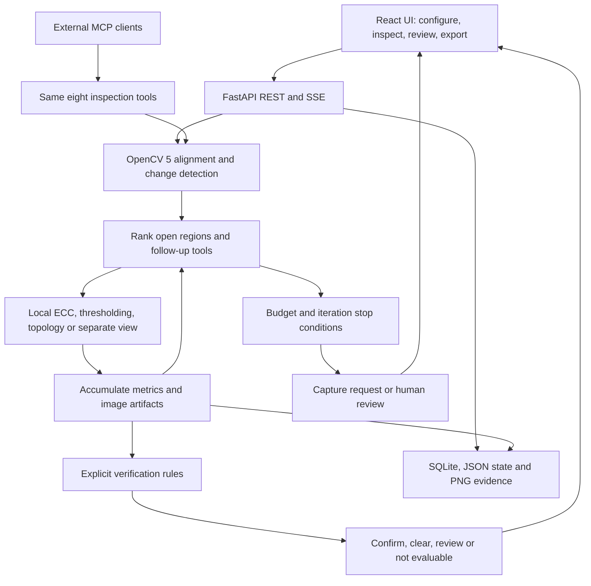
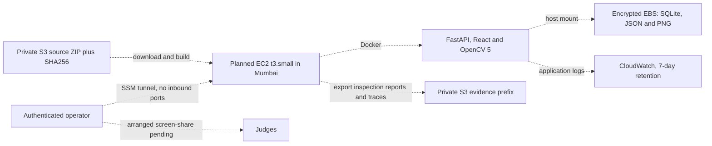

# CircuitSleuth technical report

26 October 2026 · Team **Update** · **Shikhar Goel and Ishpreet Singh**

## Problem and users

PCB inspection operators need to separate actual surface changes from glare,
misalignment and image noise. CircuitSleuth compares a reference and test board,
then investigates uncertain regions. The current product is a supervised
synthetic demonstration for inspection engineers and evaluators, with support
for uploaded images. Manufacturing accuracy and time savings are not established.

## Implemented architecture and agent workflow

The deterministic policy is in `backend/app/agent/policy.py`: current uncertainty,
severity, quality, estimated information gain, cost and repeat penalties rank
candidate/action pairs. Measured illumination and alignment flags affect which
tool runs; decisive accumulated evidence changes the next action to verification.
The policy is transparent and budget-bounded, without an LLM dependency.
Raw `plan_selected` and tool events show the actual executed sequence. The
exported planning reference list points to preceding observation events; those
references are an audit aid, not an independent causal experiment.

OpenCV 5.0.0 performs substantive analysis: SIFT/ORB feature matching, RANSAC
registration hypotheses, photometric verification and ECC refinement; normalized
image differences and local structural comparisons; topology, thresholding,
local registration and independent-view analysis. Scores are heuristics, not
calibrated probabilities. MCP calls and the web orchestrator share tools.

Recent correctness fixes repair ECC transform direction, exclude candidate
pixels from the local registration fit, compare common valid support and
require reliable local evidence before clearing a candidate. Conflicting local
and second-view evidence is escalated. Controlled probes expose the previous
false-clear failure. Details and remaining risks: [alignment fixes](ALIGNMENT_FIXES.md).

## AWS architecture — prepared, execution pending

All dashed links are a proposed deployment, not proof of executed AWS work.
`deploy/aws-ec2-demo.template.json` uses the existing Dockerfile and locks,
checks the source ZIP SHA256, builds on the host, runs an HTTP inspection,
binds the application to loopback and schedules a stop six hours after first
boot. Standard T3 credits avoid surplus CPU charges. EBS persists through
container restarts and instance stop/start but is deleted with the instance.
The deployment is single-instance, without backups or shared runtime storage.
The six-hour stop does not cap all ongoing AWS charges.

The IAM role permits the source object read, a stack-specific evidence-prefix
write, its log group and standard SSM managed-node operations. The security
group has no inbound rules. There is no public unauthenticated application
endpoint. An authenticated SSM route supports a supervised screen-share once
arranged. AWS account access and the free-plan credit balance were checked locally;
service/network/quota checks and the cloud run remain pending. App Runner is closed to new customers; its older example is
retained for existing customers only. No COOL/Graviton workload is claimed.

## Reproduction and verification

Use Python 3.13 and Node 24, install the backend lock and frontend `npm ci`.
Run `scripts/verify_local.py --include-mcp` using the virtual-environment Python.
Current local results: **101 tests passed; two Windows-specific tests skipped**,
frontend lint/build and all eight MCP tools passed. The earlier published
Linux CI also verified a real Docker build and HTTP inspection. The current
commit's Actions result is authoritative for its container checks.

`tools/export_demo_evidence.py` executes all six API demos with behavior checks,
saving reports, complete events, planning references, PNG crops and SHA256s.
Run it with `python -m tools.export_demo_evidence --out NEW_DIRECTORY` against
a disposable running API. Default URL is localhost:8080. An AWS claim additionally
requires AWS identity/instance/command evidence tied to the exported inspection
IDs; neither an environment variable nor the exporter certifies cloud hosting.

Source packages use `tools/package_submission.py`; source commit and file hashes
are embedded. DeepPCB third-party images, credentials and runtime data are
excluded. Synthetic fixtures, source, dependency locks and recorded findings
remain in the judge package. See [deployment](../deploy/README.md) and
[repository verification](REPOSITORY_VERIFICATION.md).

## Evaluation and trade-offs

Current code: 30 seeded synthetic inspections (six templates, five variants),
fixed versus adaptive on the same OpenCV core. Ground-truth matching uses IoU
0.15; reported positives are confirmed/likely verdicts. Headline precision,
recall and F1 are per-inspection macro averages, including the benchmark's
empty/refusal-case conventions. They are not binary accuracy percentages.

| Metric | Fixed | Adaptive |
|---|---:|---:|
| Macro reported precision | 0.5208 | 0.8627 |
| Macro reported recall | 0.8933 | 0.7822 |
| Macro reported F1 | 0.5751 | 0.7155 |
| False positives | 50 | 10 |
| False negatives | 6 | 8 |
| Candidate review rate | 0% | 27.27% |

The 80% reported-FP reduction has lower recall and added review workload. The
current results live in `output/ecc-verification-fix/benchmark/results.json`;
the original `evaluation/results.json` remains preserved (52 original baseline
FP). Timing is machine-specific; no cloud latency or cost measurement exists.

The 48-capture research comparison retained TP/FP/FN 87/22/33 before and after
the correctness fixes. Two of four research mismatch controls were wrongly
accepted by both versions; no new acceptances were introduced. A six-pair
external DeepPCB smoke check matched only one of thirty annotated defects,
showing substantial domain gap. These checks do not establish production
readiness. Research preprocessing ablations were not promoted wholesale:
unsafe registration fallback could accept a wrong board, and CLAHE could
increase false positives. See the retained research report and source evidence.

## Limitations and responsible operation

Core benchmark imagery and second views are separately rendered synthetic
captures; no physical camera rig is integrated. Reprocessing the same image
adds no optical information. The demonstration may miss small defects,
mishandle board identity or require more review under new imaging conditions.
Confidence is uncalibrated. Uploaded-image support is not production validation.

Keep deployment supervised. The API has no application authentication, which
is why the prepared AWS route uses SSM without inbound web access. Do not use
this demo to autonomously accept/reject safety-critical hardware. Human review
must retain the original images and evidence. Real production data, acquisition
protocols, identity gating, access control, concurrency, backups and independent
evaluation are needed before broader use.

Final competition gaps are tracked in [readiness](../submission/READINESS.md):
AWS execution, judge access/demo arrangement, required video (currently deferred
by the team), final rights/eligibility checks and actual Devpost submission.
