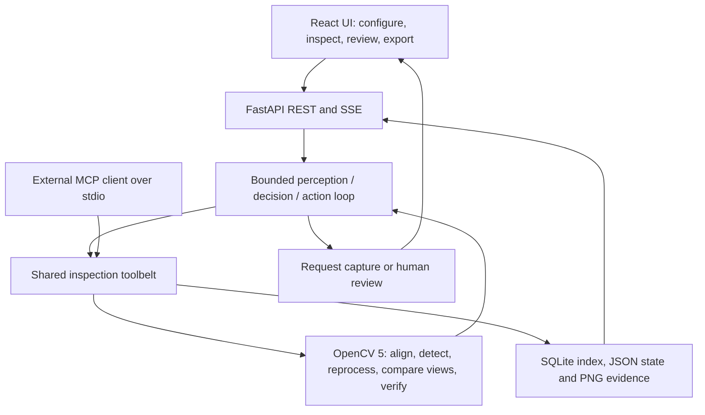
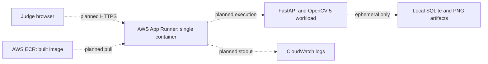

# CircuitSleuth technical report

For subsequent alignment/evidence fixes and current validation, see
[ALIGNMENT_FIXES.md](ALIGNMENT_FIXES.md). The measurements below preserve the
initial polish snapshot.

## Problem and users

PCB inspection operators need to separate actual surface changes from glare,
misalignment and image noise. CircuitSleuth compares a reference and test board,
then investigates uncertain regions instead of treating every difference as a
defect. The current product is a supervised synthetic demonstration for
inspection engineers and evaluators, with uploaded-image support.

## Implemented architecture

The UI, orchestration and MCP server share the same tool implementations.
The planner reranks open regions using uncertainty, severity, evidence quality,
information gain, tool cost and repeat penalties. Evidence changes subsequent
choices. Missing secondary captures produce a capture request and human review;
registration failure triggers recovery and then refusal to assess defects.
Tool and iteration limits terminate the loop and escalate unresolved regions.

OpenCV 5 performs substantive analysis: SIFT/ORB feature matching, RANSAC
registration hypotheses, photometric verification and ECC refinement; normalized
image differences and local structural comparisons; regional topology,
thresholding, local registration and independent-view analysis. Verification
uses an explicit rule table. Scores are heuristics, not calibrated probabilities.
See [architecture](ARCHITECTURE.md), [evaluation](EVALUATION.md), and
[MCP integration](MCP.md) for implementation details.

## AWS design and execution status

Dashed links describe the deployment template, not an executed AWS workload.
`deploy/Dockerfile` builds the React frontend and Python runtime into one image;
`deploy/apprunner-service.example.json` provides a configurable ECR/App Runner
example. AWS and container execution remain unverified. App Runner filesystem
state is ephemeral and unshared across instances; durable external artifact and
database storage are future work. The local benchmark does not establish cloud
performance, cloud cost, or COOL award eligibility.

## Reproduction and results

Use Python 3.13, `backend/requirements.lock.txt`, Node 24 or newer and
`npm ci` against the existing frontend lock. Follow [the README](../README.md)
and run `scripts/verify_local.py --include-mcp` with the virtual environment's
Python. The portable verifier uses temporary inspection data and exercises the
same eight tools through actual MCP stdio.

On macOS the final regression suite passes 54 tests, with two Windows filesystem
semantics tests skipped. The production frontend builds and lint passes. The
30-inspection synthetic benchmark reproduces all supplied non-timing outputs:
macro reported F1 0.571 to 0.716, false positives 52 to 10, reported recall
0.893 to 0.782 and an adaptive escalation rate of 26.4%. Failures, metrics,
per-region decisions and budget use are retained in the evidence artifacts.
Full review and evidence pointers: [polish review](POLISH_REVIEW.md).

## Limitations and responsible operation

All measured data is seeded and synthetic: six templates with five variants
each, matched at IoU 0.15. There is no real production PCB validation, capture-rig
integration or calibrated confidence estimate. Reprocessing adds no optical
information; a second view is a separately supplied capture. Human decisions
are recorded in events and refreshed reports. Reruns create new inspection IDs.

Keep deployment supervised: uploads and operator actions currently have no
application authentication. Do not use the demo to autonomously accept or
reject safety-critical hardware. Use human review for unresolved evidence and
retain reports with the original captures. Validate real board diversity,
optical quality, limits, concurrency and persistent storage before wider use.
