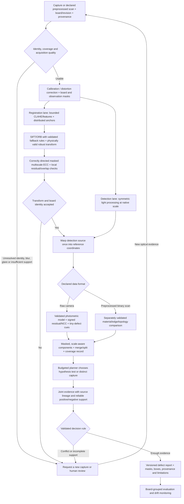

# CircuitSleuth: evidence-backed pipeline improvement research

**26 October 2026 · Codex · local CPU research · no production changes promoted**

The best next step is to repair evidence handling, image-lane consistency and transform conventions, then validate on a broader board-grouped corpus. A new neural detector is premature. Several plausible classical enhancements regressed, and a small external dataset smoke test exposed a much larger domain gap than the synthetic headline suggests.

The strongest measured candidate is symmetric, lightly filtered detection imagery with correctly directed ECC. On 48 new synthetic captures, the experimental bundle reduced final reported false positives from 22 to 7 at the same 87/120 reported defect observations. **The bundle also accepted two wrong boards that the current implementation refused**, because it expanded the ORB fallback. It therefore fails promotion. Failure isolation supports retaining the ECC direction correction while rejecting that fallback expansion until board-identity gates improve. The shading method selected on tuning was weaker after verification and must not become the default.

Read the original benchmark and new experiments as separate evidence. Neither establishes production PCB accuracy. Six DeepPCB test pairs, using real scan backgrounds with artificially added defects, yielded only **1/30** candidate matches for the current pipeline at IoU 0.15. That small purposive sample is a compatibility warning, not an estimate for the full dataset.

## Scope, evidence and preservation

Production backend/frontend, API and artifact contracts, original datasets, dependency locks, original evaluation results, source archives and git state were not intentionally changed. Research code, generated captures, results and this report live under `research/pipeline-improvements/`. SHA-256 preservation evidence is in [preservation-before.json](preservation-before.json) and [preservation-check.json](preservation-check.json). The research used existing dependencies; no model training, global dependency installation, deployment, paid compute, publication or submission occurred.

The investigation followed the Obsidian independent-judgment protocol: neutral memory and direct code first; an independent position was saved to `11 Codex/Projects/CircuitSleuth Pipeline Independent Take 2026-10-26.md` before reading the older polish review and reports. After reveal, the position **refines** their preservation recommendation: retain the product and evidence-driven architecture, but the documentation overstates several reliability properties that the code and probes do not support. No Claude/Cursor position was inferred or simulated.

I used Exa across six research workstreams, requesting 100 search-result slots, including duplicates; this is not 100 unique verified sources. Primary documentation, original papers, implementation repositories and dataset records support the claims below. [source-evidence.json](source-evidence.json) stores research retrieval evidence; [figshare-metadata.json](figshare-metadata.json) independently records the dataset license returned by its API. Methods described as **proposed/untested** have not demonstrated gains in this implementation.

## 1. What the implementation actually does

| Stage | Direct implementation evidence | Consequence |
|---|---|---|
| Input | `cv/imaging.py` decodes 8-bit BGR, converts to grayscale; checks bytes and dimensions | No measured focus, board coverage, glare, clipping, scale, calibration, exposure or capture identity gates. Higher-bit capture information is not retained in this lane. |
| Registration preparation | `cv/preprocess.py:22–51`: CLAHE 2.0/8×8, then median 3×3 | Reasonable feature-extraction options, but adaptive contrast changes pixel photometry. |
| Global registration | `cv/registration.py`: mutual ratio SIFT/ORB, partial affine RANSAC, coverage and photometric checks, ECC | Substantive OpenCV implementation; shared silk/rings and periodic trace rows can still support wrong-board consensus. |
| Detection input | `tools/registry.py:224`: median-only reference against `reg.warped_test`, which contains registration CLAHE | The two detector inputs have different transformations. The same mismatch exists in the fixed benchmark and MCP rehydration. The color aligned-test display is separately warped and does not prove that detection used those pixels. |
| Detector | `cv/detection.py:95–148`: σ=61 mean transfer, local NCC 15, Otsu/max percentile 97/max 10 threshold, material-added channel, opening 3, closing 17 then 5 | Thresholds and kernels are fixed in pixels. Smooth additive normalization is not full multiplicative gain invariance. Large changes can contaminate estimated background. |
| Candidates | Component area 12 px to 5% image area; max 40; score sort by difference × mismatch | Small defects can disappear before verification. Added material on flat background can have zero mismatch and be ranked too low despite its separate detection channel. |
| Secondary analyses | Zoom, Canny geometry, adaptive binary difference, local ECC, alternate capture | Most reuse the same pixels. A 4× interpolation gives no additional optical resolution. Secondary measurements do not consistently reuse the detector’s photometric normalization. |
| Alternate capture | Global registration then crop statistics; `region_tools.py:274` treats a large difference/mismatch as a reliability gate | Difference magnitude is not an alignment-quality measurement. `secondary_valid_mask` exists but is not used by this tool. Missing/anomaly-free evidence is often inconclusive rather than a reliable negative. |
| Planner/verifier | Fixed weights, “information gain” 1 for unseen tool / 0.1 for repeated tool; ordered rule table | Transparent heuristics, not calibrated information gain or independent evidence fusion. Strong same-image tool agreement may confirm; local realignment refutation precedes supporting independent evidence. |
| Recovery | `registry.py:181`: recovery sets CLAHE=True, which is already the default | The advertised changed preprocessing is not a different parameter configuration under defaults. Repeating it is not a substantive recovery strategy. |
| Evaluation | Six procedural templates × five seeds; IoU 0.15; greedy candidate order; per-image average metrics | No classification accuracy; clean/refusal cases affect macro numbers. A second candidate cannot fall back to its next-best unmatched annotation. |

Other audit findings: `dilate_px` is declared but unused in detector padding; reference “structureless” exclusion also excludes residual standard deviation >60, so it suppresses some highly structured regions; Otsu sees the whole difference map while its percentile only masks warp validity; observation-invalid pixels remain in these statistics; validity is applied before morphology but is not reapplied after it. The border flag requires an invalid pixel inside the bounding box as well as nearby, so adjacency alone is insufficient. These are source findings; the held-out synthetic study recorded zero post-morphology warp-invalid pixels and does not establish that every concern manifests there.

### Confirmed correctness probes

All values below are reproducible in [results/probes.json](results/probes.json), [registration-followup.json](results/registration-followup.json) and [evidence-conflict-probe.json](results/evidence-conflict-probe.json).

* **ECC direction:** OpenCV explicitly requires inverse warping of the input with its returned ECC matrix. CircuitSleuth passes a forward test→reference matrix as the initializer and applies the returned matrix as a forward warp. A known +3/−2 px capture had unaligned interior MAE 15.15; current ECC increased it to 18.60; inversion at the API boundary reduced it to 1.62. This is a transform-convention defect, not evidence for changing the whole registration model. [OpenCV 5 ECC](https://docs.opencv.org/5.0/main_modules/video_track.html), [warp conventions](https://docs.opencv.org/5.0/main_modules/imgproc_transform.html).
* **Local ECC units:** `before` uses 0–255; `after` uses 0–1. A real injected defect produced before=8.47, after=0.07, “99.16% reduction” and `supports_defect=False`. A prototype with consistent units, inverse warping and a correlation reliability gate retained uncertainty instead. Pure translated texture also remained inconclusive in that small crop: border support still needs fixing. The prototype is not a completed local verifier.
* **Conflicting evidence:** the current verifier returns `CLEARED` when local realignment refutes a candidate even if an independent view supports it. Repairing units alone does not fix this precedence hazard.
* **Observation validity:** a 10×10 invalid island vanished entirely when the valid mask was dilated with the current 31×31 kernel. Eroding valid pixels expanded the invalid region to 1,368 pixels, as expected. This establishes the direction error for a raw-image validity mask, but **does not justify erosion on binarized datasets**. [OpenCV morphology](https://docs.opencv.org/5.0/main_modules/imgproc_filter.html).
* **RANSAC repetition:** four current-style calls on the same correspondences produced one unique matrix. The loop does not guarantee distinct hypotheses. Vary sampling/subsets or explicitly retain genuinely different spatial/model hypotheses and record the seed.
* **Matching:** two overlapping GT boxes and two valid candidate boxes give current scorer TP=1/FP=1/FN=1; maximum-cardinality one-to-one matching gives TP=2/FP=0/FN=0. Existing results remain unchanged; a new scorer must be versioned and both scorers retained during comparison.
* **Annotation geometry:** 4 of 24 isolated generator boxes missed changed pixels. Three mousebite boxes missed roughly 4–6%; one open-circuit box missed 28.7%. The open removal ellipse rotates but its returned box does not rotate with it; supersampling/flooring and shape placement also matter. Fix future annotations from an independently rendered defect mask, not by enlarging boxes to fit predictions.

## 2. Frozen original benchmark

These are the supplied, preserved 30-inspection results, not results from this research:

| Original metric | Fixed pipeline | Adaptive agent |
|---|---:|---:|
| Macro reported precision | 0.5158 | 0.8627 |
| Macro reported recall | 0.8933 | 0.7822 |
| Macro reported F1 | 0.5705 | 0.7155 |
| TP / FP / FN | 44 / 52 / 6 | 42 / 10 / 8 |
| Derived micro precision / recall / F1 | .4583 / .8800 / .6027 | .8077 / .8400 / .8235 |
| Candidate escalation rate | 0 | 26.36% |
| Mean tool calls | 0 | 4.6 |

Micro values were recomputed from the preserved row counts and are a new explanatory derivation, not replacements for the original macro values. IoU is 0.15. Empty/refusal cases receive perfect empty scores under the existing convention. Wrong-board refusal must be reported as refusal, not a clean-board success. There is no overall classification accuracy. The original JSON snapshot and hash are in [results/original-baseline-snapshot.json](results/original-baseline-snapshot.json).

## 3. Isolated experiments and what changed the recommendation

### Protocol and limits

[PLAN.md](PLAN.md) was written before held-out generation. Four tuning board identities (200001–200004) and eight test identities (300001–300008) each received six capture profiles: clean, mild defects, gain/offset, glare, small pose change, and blur/noise. Each board has three fixed physical defects rotating through the six defect types; five defective captures repeat them. Thus the test contains 48 captures and 120 defect observations, but only **eight board clusters and 24 physical defect instances**. Twenty observations of a type represent only four physical instances. They are not 120 independent production defects.

No training occurred. No existing 30-case image or result was optimized. The detector receives only pixels and its own registration; GT/known synthetic poses enter scoring only. Registration outputs were cached per image and shared across detector ablations. All ten treatments were fixed in advance; selection used tuning micro candidate F1 at IoU .15 with no clean-candidate FP or recall decrease versus symmetric+ECC. **Multiplicative correction was locked before test generation.** Reporting the other test ablations is descriptive; choosing a new winner from them would require another test set.

Evaluation uses maximum-cardinality one-to-one matches at IoU .15/.30/.50 and retains original-scoring sensitivity. Candidate localization and final reported defects are separate. Three treatments were passed through the unchanged policy, region tools and verification rules in a memory-only driver with the same 12-call and 24-iteration limits. Three legacy cases matched the actual persisted orchestrator exactly in boxes, statuses, tools and call counts, using isolated storage: [orchestrator-parity.json](results/orchestrator-parity.json). This validates those harness cases, not every possible orchestrator behavior.

The `symmetric_ecc` experiment bundles **two** registration changes: ECC inversion and continuing to ORB after poor SIFT. It must not be interpreted as a pure ECC ablation. The follow-up below separates them. Optional detector treatments all use that same bundled registration. Median filtering occurs in the capture lane before the final warp. Symmetric+CLAHE is applied only for that named detection treatment. Global robust gain is a four-pass trimmed least-squares affine intensity fit; multiplicative correction uses a clamped low-frequency mean ratio [.5, 2]; eroded validity replaces dilation with erosion. These are modest prototypes, not fully calibrated physical models.

### Held-out candidate localization

| Treatment | TP / FP / FN | Micro P | Micro R | Micro F1 .15 | F1 .50 | Clean false candidates / 8 |
|---|---|---:|---:|---:|---:|---:|
| Existing pipeline | 109 / 78 / 11 | .583 | .908 | .710 | .319 | 9 |
| Symmetric grayscale, existing registration | 107 / 61 / 13 | .637 | .892 | .743 | .326 | 2 |
| Symmetric + ECC/ORB bundle | 108 / 59 / 12 | .647 | .900 | .753 | .334 | 2 |
| Smaller morphology (opening 1, closing 3/3) | 111 / 97 / 9 | .534 | .925 | .677 | .299 | 3 |
| No median | 108 / 56 / 12 | .659 | .900 | .761 | .246 | 2 |
| Bilateral 5/20/3 | 107 / 59 / 13 | .645 | .892 | .748 | .252 | 2 |
| Symmetric detection CLAHE | 109 / 136 / 11 | .445 | .908 | .597 | .351 | 27 |
| Robust global gain/offset | 104 / 51 / 16 | .671 | .867 | .756 | .262 | 0 |
| Multiplicative shading, selected on tuning | 110 / 60 / 10 | .647 | .917 | .759 | .297 | 4 |
| Eroded observation validity | 108 / 52 / 12 | .675 | .900 | .771 | .343 | 2 |

Machine values, including all IoUs, per-profile/type/size counts and timing, are in [test-summary.json](results/test-summary.json) and [test-rows.json](results/test-rows.json). No optional method is promoted by this table. The legacy greedy scorer and maximum-cardinality scorer produced equal TP counts on these three main treatments in the held-out study; the constructed matching defect did not create their measured improvement.

**Tradeoffs:** symmetric processing reduced clean candidates but lost two localized defect observations relative to legacy; the ECC/ORB bundle recovered one. Smaller morphology improved recall while increasing FP and did not improve strict-IoU F1. Robust gain cleared clean candidates but lost five TPs. CLAHE amplified false alarms. The tuning-selected multiplicative method improved gain-profile candidate F1 (.746→.902 versus legacy) but worsened pose (.902→.836 versus symmetric bundle) and blur/noise (.898→.857 versus legacy). Glare remained difficult: 34 false candidates for symmetric bundle versus 37 legacy across eight glare captures. These are condition-specific results, not a universal ranking.

At IoU .30 the legacy/symmetric-bundle/multiplicative F1 values are .691/.739/.690; at .50 they are .319/.334/.297. Tight localization remains a major weakness. A high low-IoU recall does not prove accurate defect boundaries or correct electrical type.

### Final claims, abstention and wrong-board controls

| Unchanged policy/verifier, new captures | Legacy | Symmetric+ECC/ORB | Multiplicative |
|---|---:|---:|---:|
| Reported TP / FP / FN | 87 / 22 / 33 | 87 / 7 / 33 | 86 / 17 / 34 |
| Micro reported precision | .798 | .926 | .835 |
| Micro reported recall | .725 | .725 | .717 |
| Micro reported F1 | .760 | .813 | .771 |
| Candidate review/NOT_EVALUABLE fraction | 25.1% | 25.1% | 34.1% |
| Mean tool calls / capture | 5.25 | 4.56 | 4.44 |
| Final false alarms on 8 clean captures | 5 | 0 | 1 |
| Fully automatic capture decisions / 48 | 24 | 30 | 25 |
| Errors among those automatic decisions | 2 | 0 | 1 |

Automatic capture-level coverage was 50.0%/62.5%/52.1%; observed selective board-label risk was 2/24, 0/30, 1/25. A zero in this tiny repeated synthetic sample is not a safety bound. Capture-level “any defect” decisions can be right while missing another defect on the same board; always retain full localization recall. Missing-view gain captures still generated review requests; recall was not increased by suppressing honest escalation. [Operating points and descriptive score sweeps](results/operating-points.json) retain the precision/recall tradeoff; their thresholds were not selected for deployment.

Board-cluster bootstrap (2,000 resamples) gave the candidate-F1 difference, symmetric bundle minus legacy, a 95% percentile interval of **−.015 to +.105**. The multiplicative interval was −.017 to +.104. Both include zero; the eight procedural board groups are too few and too homogeneous for a superiority claim. See [test-board-bootstrap.json](results/test-board-bootstrap.json).

**Wrong-board rejection overrides F1 improvements.** On two held-out mismatched pairs legacy refused 2/2 while the bundle accepted 2/2 with marginal ORB coverage .375 and photometric agreement about .59/.64. On two tuning mismatches **both** accepted 2/2, including a falsely “good” SIFT result. Neither implementation has a dependable identity gate. The current six-template wrong-board scenario did not expose these pairs.

The follow-up crossed ECC direction correction and expanded ORB fallback independently. Across the same four mismatches, legacy and ECC-direction-only accepted 2/4; ladder-only and the bundle accepted 4/4. Thus the expansion caused the additional failures. Across four new pose boards (500001–500004), all variants registered; mean corner errors ranged .026–.037 px with ECC direction fixed versus .051–.090 px without it. These follow-up controls explain causality; they are not a second untouched test set for selecting detector settings. All 48 matched test primary registrations used SIFT, so the ORB expansion was not invoked in those primary alignments.

### Tiny defects

Symmetric bundle localized 19/20 open, 19/20 short, 20/20 mousebite, 19/20 spur, 20/20 spurious-copper and **11/20 pinhole observations**. These are localization sensitivities, not predicted-class accuracies. Pinhole recall was 0/10 in tuning and 11/20 in test, showing substantial board-instance dependence. Smaller kernels and removing median did not solve it consistently.

An independent diagnostic on four new boards (400001–400004) isolated a failed 9×9 pinhole: 30 pixels exceeded the difference threshold, 16 survived the combined base gate, and only 11 remained after morphology, below the hard minimum area 12. This is a concrete bottleneck for a separate tiny-defect channel. It does not justify globally lowering area thresholds: the smaller-kernel ablation already increased FP. [Defect-stage diagnostics](results/diagnostic-defect-stages.json).

### External compatibility smoke: DeepPCB

Six pairs were chosen by the first listed test example in six named scan groups, not by score; 18 files were downloaded from pinned repository commit `08e98c4db5922613fb97176eb3d6497d48260cb1` and verified against Git blob hashes and SHA-256. [Download provenance](results/deeppcb-download-manifest.json), [scores](results/deeppcb-smoke.json), [download/evaluation script](external_smoke.py).

| Candidate matching, IoU .15 | TP | FP | FN | Micro F1 |
|---|---:|---:|---:|---:|
| Current pipeline | 1 | 28 | 29 | .034 |
| Symmetric+ECC/ORB | 2 | 24 | 28 | .071 |
| Eroded validity | 0 | 0 | 30 | .000 |

The images are 95.6–99.6% near the gray rails (≤5 or ≥250), which is legitimate for their binarized scan format. Treating those rails as raw-sensor clipping and eroding validity removed all detections. Registration still returned good/marginal for every pair, so a positive global registration status did not ensure usable detection. A simple supplied-alignment XOR diagnostic matched 22/30 annotations but generated **892** unmatched components; it is not an alternative pipeline. It shows recoverable difference signal together with severe threshold/morphology/annotation challenges. The current detector also emitted numerical warnings from square roots of tiny negative variance approximations; clamp variance in all paths.

This sample does not support a DeepPCB benchmark claim, a production-accuracy claim or transfer of these settings to raw camera photographs. It establishes the need for an explicit acquisition/data-format contract and a separately validated scan lane. Full external evaluation should use the published split and group-aware sensitivity, not these six reused diagnostic pairs as a fresh holdout.

## 4. Ranked implementation and experiment matrix

Effort estimates are engineering estimates for this codebase, excluding hardware acquisition and collection/annotation. S≈hours, M≈1–3 days, L≈multiple days plus data. No percentage improvement is forecast.

| Rank / horizon | Precise bottleneck and proposal | Implementation location | Evidence / tradeoff / effort | Ablation and acceptance gate |
|---|---|---|---|---|
| 1 · safe near-term | Repair local ECC units/direction; require reliable common valid support; conflicting local/view evidence→review; never clear on failed ECC | `cv/region_tools.py:199–246`, `cv/verification.py:87` | Injected real defect currently cleared; OpenCV ECC convention. May increase review. S–M | Known translations, real injected removal/addition, glare and blank crops; preserve a real defect under all tested realignment hypotheses; reliable pure shifts may clear; conflicts cannot clear. |
| 2 · safe near-term infrastructure | Version a duplicate-safe scorer and annotation-mask audit; preserve legacy results | `evaluation/benchmark.py:113`, generator render/defect paths; future research evaluator | Controlled 1→2 TP matching discrepancy, 4/24 incomplete boxes. No visual gain by itself. M | Duplicate, merged, split, nested, zero-GT, exact-threshold and coordinate tests; class-aware and class-agnostic scores; corrected GT independent of predictions. |
| 3 · near-term candidate | Separate registration and detection images; warp equally prepared raw/light reference/test/secondary lanes; persist exact preparation metadata | `cv/registration.py`, `tools/registry.py:134–147,224,339–366`, MCP rehydration, fixed baseline | Strong source evidence and lower FPs in synthetic ablation, but raw candidate recall regressed. M | Raw-source pixels and parameter hashes agree across REST/in-process/MCP; detector and secondary tools use consistent lanes; no unacceptable per-type recall loss after recalibration on tuning only. |
| 4 · near-term candidate | Correct ECC API boundary while retaining existing fallback order; add bounded transform and regional quality checks | `_ecc_attempt`, `_ecc_refine`, `register` | Controlled MAE and new pose boards support direction fix. Do not bundle ORB expansion. S–M | Inverse/forward and pyramid-scale tests, no negative determinant or implausible scale/shear, no corner-error regression; all existing wrong-board refusals remain refusals. |
| 5 · necessary before wider use | Explicit board/revision identity, fiducials/CAD anchors, distinctive-region and local residual agreement; reject unresolved identity | registration plus input/template metadata | Current and expanded ladders accept wrong boards. Tightening a global correlation threshold alone could reject valid lighting changes. M–L | Unseen wrong revisions, same-silk/different-net boards, periodic-row offsets, 180° rotations and partial crops; zero new false accepts in refusal suite; hold out identities. |
| 6 · near-term gated | Data-format-aware validity: raw clipping/saturation, board/warp masks, masked statistics, post-morphology remasking and incomplete-coverage review | `cv/detection.py:95–148`, imaging/config/context | Dilation contradicts intended raw mask; erosion fails every sampled binary pair. M | Raw saturation island and halo tests **and** legitimate binary/bright copper cases; no “clean” verdict from unobserved regions; masks propagate to every secondary tool. |
| 7 · medium-term | Native-scale tiny-defect path, polarity-specific thresholds, hysteresis/component persistence; avoid 17 px merging for tiny defects | `cv/detection.py`, regional selection | Concrete 11px/12px rejection and weak pinhole sensitivity; blanket morphology change increases FP. M | Defect-width and area strata, near-adjacent defects, salt noise and registration residuals; improve tiny sensitivity at fixed false alarms per board and fixed review budget. |
| 8 · medium-term | Reliable alternate-view gate independent of anomaly magnitude; provenance, quality, valid support, same board/component; measured negatives | `ToolContext`, `tool_alternate_view`, verifier | Current `gate_ok` is anomaly-derived and ignores secondary mask. Needs capture metadata/new examples. M | Duplicate image/resave is not independent; misaligned, clipped, missing, clean and contradictory second views; preserve review on unresolved conflict. |
| 9 · medium-term experiment | Compare robust affine gain/offset, coarse multiplicative fields, masked quantile matching and calibrated flat field | preprocessing/detection plus acquisition metadata | Gain methods show mixed synthetic tradeoffs; multiplicative tuning winner is weaker after verification. M | Fit on valid nondefect evidence without GT at inference; freeze tune parameters; evaluate new board groups, large defects, glare and final-policy effects. Retain raw residual for audit. |
| 10 · medium-term | Calibrate joint region evidence and action utility/cost on held-out board groups; preserve strict abstention | `policy.py`, `verification.py`, evaluation | Current costs/info gain are constants; tools share evidence. Additional labels needed. M–L | Compare current ordered policy, cheap-first and value-of-information policy under same 6/12/24-call budgets; full recall, selective risk/coverage, deadline and cost, not F1 alone. |
| 11 · new hardware/data | Stable illumination, exposure/focus, calibration and real multi-capture dataset | acquisition boundary and image-quality records | Optics sources support mechanisms; not tested on this hardware. L | Paired rig experiment varying one acquisition factor at a time; quantify clipping, blur, smallest resolved feature and FP/board across capture days. |
| 12 · new data/training | Classical + normal-only anomaly model first, then supervised segmentation/detection where labels justify it | separate model adapter and tool evidence source | Original PatchCore/EfficientAD/detection sources; no trained model evaluated here. L | Board-grouped external/target data; identical image resolution and alarm budget; compare against corrected classical lane; model-specific license/export/latency verification. |

**Rejected as defaults now:** unconditional detection CLAHE; expanded ORB fallback under current gates; eroding every rail-based validity mask; changing all morphology for tiny defects; promoting the multiplicative tuning winner from candidate F1; replacing review with a confident single-image verdict. Eroded validity’s good synthetic F1 does not outweigh its external complete miss. These are measured reasons to retain a change behind an experimental switch or reject it, not reasons to hide the trial.

## 5. Comprehensive method inventory and fit to this implementation

### Capture and quality

**Lighting:** use diffuse dome or diffuse coaxial lighting to control broad reflections; compare brightfield with directional/darkfield illumination for scratches/foreign objects. Cross-polarize source and lens where the surface responds usefully. Polarization reduces light and may change which defects have contrast; optimize it with exposure and motion limits, not as a universal fix. A fixed fixture, camera distance and repeatable pose reduce registration workload. These are hardware hypotheses for this system, supported by [Edmund’s illumination/polarization guide](https://www.edmundoptics.com/knowledge-center/application-notes/illumination/choose-the-correct-illumination/) and [PCB dome-light example](https://www.edmundoptics.com/knowledge-center/application-notes/illumination/brightfield-illumination-with-dome-lights-for-machine-vision/).

**Exposure/focus:** lock exposure, analog gain and white balance after tuning a board family; record settings and capture IDs. Use diffuse copper/silk targets to detect clipping, exposure imbalance, blur or motion streaks. Sharpness from Laplacian/Tenengrad must be calibrated against known good captures at the same material/scale; a fixed number across different PCB textures is unreliable. Reacquire an image when the smallest required feature cannot be resolved. HDR/exposure brackets can add observation support but require motion registration and retained original frames; interpolating/upscaling cannot reconstruct an unobserved pinhole.

**Flat field:** under a linear sensor model correct `I = S·R + D` with measured dark frame D and bright field F: `(I−D)/(F−D) × reference_level`, clipping unstable denominators into an invalid mask. Acquire calibration at the working exposure/gain/lens/temperature and revalidate after changes. Avoid correcting a saturated pixel as if it contained recoverable reflectance. [Basler calibration guidance](https://docs.baslerweb.com/flat-field-correction) describes acquisition requirements; [BaSiC](https://www.nature.com/articles/ncomms14836) supports retrospective shading models in microscopy, not proven PCB performance. A repeated PCB trace pattern can violate assumptions used to estimate illumination from scene content.

**Geometric calibration and masks:** calibrate lens distortion at the working focus and resolution, undistort reference and captures consistently, and map results back to the existing reference coordinate space. Use board outline/fixture/CAD masks and measured px/mm; keep board-edge defects within inspected coverage. Image size equality alone is not calibration. [OpenCV camera calibration](https://docs.opencv.org/4.x/dc/dbb/tutorial_py_calibration.html). Reject or explicitly mark incomplete coverage for the wrong revision, cropped board, severe blur/glare, insufficient overlap or ambiguous identity.

### Preprocessing

| Method | Fit, risk and status |
|---|---|
| Grayscale vs B/G/R, Lab L/chroma, HSV value/saturation | Current grayscale discards potentially useful copper/mask color separation. Select channels per board family on tuning data; preserve color for contamination/oxidation. Hue is unstable at low saturation, and auto white balance changes channels. **Untested here.** |
| Symmetric light processing | Highest priority image-lane repair. Keep registration features separate and transform the detection source once. Tested; improves precision with some raw-recall regression. |
| Global robust gain/offset | Trimmed fit avoids allowing a few defects to dominate photometric alignment; cannot model spatial glare/nonlinear clipping. Tested; clean-FP gain, defect-recall loss. |
| Local additive mean transfer | Existing σ61 removes smooth offsets; multiplicative trace contrast remains after subtraction. Protect low-frequency defect evidence with raw/polarity residuals and bound the illumination model. |
| Multiplicative or low-order shading field | Tested limited ratio; helps gain profile, worsens final verification balance. Next: masked coarse field robustly fitted outside automatically suspected changes, with cross-validation and fit-failure fallback. Never use GT masks at inference. |
| Histogram/quantile matching | Global robust percentiles or monotone LUT on board-valid nonsaturated regions can reduce exposure differences; trim tails and fit with many normal pixels. Match per material where justified. Full matching may suppress real color/material changes or be distorted by a large defect. **Untested.** |
| CLAHE/global equalization | Useful feature-extraction option; independently fitted local LUTs change inter-image photometry and noise. Symmetric detection CLAHE regressed badly here. Retain as a registration ablation only until validated. [OpenCV explanation](https://docs.opencv.org/4.x/d5/daf/tutorial_py_histogram_equalization.html). |
| Retinex/homomorphic filtering | Candidate registration/display or coarse illumination normalization; can alter absolute defect contrast and generate halos. Gray-world/color-restoration assumptions are not neutral for mostly green PCBs. **Untested.** Original [multiscale Retinex paper](https://doi.org/10.1109/83.597272) establishes a visual enhancement method, not PCB detection gains. |
| Median/Gaussian/bilateral/guided filters | Median can delete small dark holes; Gaussian mixes edges; bilateral can preserve edges but changes weak details and adds compute. No-median and bilateral were tested, with mixed results. Guided filtering/NLM are **untested**. Compare at fixed smallest defect width, not image appearance. [OpenCV filter API](https://docs.opencv.org/5.0/main_modules/imgproc_filter.html). |
| Glare masks and inpainting | Mask raw clipping/halo only with data-format context; separate unobserved regions from normal regions. Inpaint for display or feature extraction only, never as evidence that the board is clean. New capture is needed behind glare. |
| Scale handling | Express NCC/normalization/morphology thresholds relative to px/mm or minimum defect width. Downscale for registration, retain native detection resolution. Include interpolation/filter history and support masks in artifacts. **Untested scale-normalized redesign.** |

### Alignment

Keep the lowest-degree motion model justified by acquisition: translation/Euclidean or similarity for a fixed rig; full affine for justified tilt/shear; homography for a planar board under perspective. Homography can overfit local matches; flex/warpage is not solved by a single plane. Use board identity and distributed fiducials before permitting more freedom. Blank/repeated regions need distinctive anchors, not more RANSAC votes from the same pads.

The existing mutual ratio matcher and coverage checks should be retained. Add descriptor-distance/spatial uniqueness diagnostics, separate held-out anchor validation, forward/backward consistency, determinant/scale/shear/overlap checks and tile residual maps. Preserve multiple **different** hypotheses only when they are actually distinct. Recompute support and residual quality after ECC; the current keypoint residual metadata can otherwise describe the pre-refinement transform. A recovery ladder should change evidence/model or preprocessing parameters, logging why; repeating default CLAHE is not new recovery.

ECC should use a well-initialized, masked coarse-to-fine transform with explicit inverse convention and bounded changes. Installed OpenCV 5 exposes `findTransformECCWithMask` and `findTransformECCMultiScale`; this is an availability check, not validation of their performance or parameter signatures here. Use stable annular/context pixels for local alignment and evaluate the suspected core afterward; unconstrained local affine/flow can move away a real defect. Sparse local residuals may indicate lens calibration or board warpage. Dense flow/TPS should be a diagnostic before becoming a correction, with deformation bounds and raw difference retained.

USAC/MAGSAC/PROSAC are worth an estimator ablation where supported. **The installed wheel rejects `USAC_MAGSAC` for `estimateAffinePartial2D`; it accepts it for `estimateAffine2D` and `findHomography` in the probe.** Do not paste that flag into the current function. Switching to full affine/homography adds degrees of freedom, so keep model/estimator changes separate. [OpenCV USAC tutorial](https://docs.opencv.org/5.0/tutorials/calib3d/usac.html). LightGlue with SIFT descriptors is a later matcher candidate; LoFTR is another for sparse/texture-poor views, but neither establishes PCB identity or cures periodicity without validation. [Official LightGlue code and weights](https://github.com/cvg/LightGlue) are Apache-2.0, with distinct restrictive SuperPoint terms; [LoFTR](https://github.com/zju3dv/LoFTR) is Apache-2.0. Both add dependencies/compute and were **not run**.

### Detection and localization

Retain a **high-recall candidate union** of complementary cues, then validate their joint operating point. Useful candidates include signed normalized intensity residuals for material addition/removal; local ZNCC with variance/support confidence; SSIM or its contrast/structure terms; multiscale gradients/edge-distance or chamfer residuals; and material-mask/topology differences. Full SSIM includes luminance and contrast and is not simply a gain-invariant drop-in. Its original work evaluates perceptual image similarity, not PCB defect probability. [Original SSIM paper](https://ece.uwaterloo.ca/~z70wang/publications/ssim.html). These alternative cue combinations were **not tested** here.

Replace single whole-image percentile domination with a comparison of masked robust noise thresholds (MAD or clean-reference quantiles), material-aware/tile thresholds and hysteresis. Fit noise/background on normal tuning captures; bound how much foreground defects influence it. Preserve sensitivity to a defect larger than the top 3% tail. Avoid a universal floor for both large shorts and 3px holes. Compute NCC variance in stable precision, clamp cancellation negatives, and regard low-texture NCC as unavailable evidence rather than zero anomaly likelihood. A separate material-removed-on-flat channel is worth testing alongside the added-material channel.

Use defect-aware morphology: connected-component area/shape filters, directional kernels for thin traces, reconstruction/hysteresis to preserve weak extensions, restrained merging and watershed/context splitting for adjacent defects. A 17px closing can merge separate defects, fill meaningful holes and enlarge boxes; removing it can fragment a true short. Preserve component masks and source cues, not just boxes. Rank uncertainty/severity using calibrated cue combinations so the flat-background added-material path is not disadvantaged by a zero NCC score. Max-40 truncation and “large area” rejection must be visible as coverage/budget limits.

For high resolution, use overlapping native-resolution tiles and a low-resolution global candidate pass. Tile halos must account for the actual Gaussian/NCC/morphology dependency radii; σ61 is much larger than a small patch overlap. Merge components consistently across tile boundaries, retain original coordinates and image-scale area rules, and test a defect exactly on every seam. Do not resize an entire high-resolution board to 640px and expect tiny defects to survive. A binary scan lane should use its supplied segmentation/prealignment with carefully validated XOR/edge/topology morphology, not a raw-photo saturation heuristic. The naive XOR trial’s 892 FP illustrates the work still needed.

### Verification and orchestration

Record an evidence graph with capture IDs, pixel source, preprocessing lineage, transform/mask versions and quality metrics. Zoom, edges and adaptive threshold are correlated observations of one capture; deduplicating by tool name is not independence. Combine their measurements jointly and calibrate on whole held-out board groups, or retain explicit conservative rules. Avoid multiplying tool “confidences.” A new capture only adds evidence if it is distinct, correctly registered and observably covers the region; store/hash raw bytes and capture metadata while allowing legitimate repeated exposures.

The alternate-view gate should measure registration residual/support, exposure, focus and inspected coverage independently of the anomaly score. A valid negative needs that gate too. Strong conflicting sources, failed local ECC, insufficient observed support and missing views must produce review/recapture. Local realignment cannot take automatic precedence over reliable independent persistence. If confirmation must mean independent optical evidence, enable and test that policy explicitly; current config defaults permit same-capture confirmation.

Calibrate final decisions with joint feature models or validated rules: tune operating thresholds and optionally isotonic/logistic calibration using grouped validation and freeze them before testing. Scores remain heuristic until reliability is measured. Report selective risk versus coverage and defect misses at fixed false-alarm and review budgets. The current unseen-tool constant is a novelty proxy; a future action score should estimate expected reduction in decision risk per measured latency/capture cost, conditional on current evidence and previous tool outcomes. Measure marginal value of reprocessing versus a different exposure/lighting capture, reserve budget for closeout, and batch/cache secondary alignment rather than re-registering on each inconclusive region. **These policy changes are untested.**

### Learning and hybrid alternatives

| Approach | When it fits / practical constraints / status |
|---|---|
| PatchCore / PaDiM-style normal feature models | Good first learning experiment when many representative normal boards/captures but few defects exist. Patch memory/Gaussian statistics need board-family diversity and uncontaminated normal data; high-resolution tiling, feature stride and memory size matter for tiny defects. [Original PatchCore paper](https://openaccess.thecvf.com/content/CVPR2022/html/Roth_Towards_Total_Recall_in_Industrial_Anomaly_Detection_CVPR_2022_paper.html), [author implementation](https://github.com/amazon-science/patchcore-inspection), Apache-2.0 code. Pretrained backbone/weights and data terms are separate checks. **No training or inference run here.** |
| EfficientAD teacher/student + autoencoder | Potential compact runtime after per-domain normal training. Paper GPU millisecond figures do not apply to this CPU, tiling or service. [Original WACV paper](https://openaccess.thecvf.com/content/WACV2024/html/Batzner_EfficientAD_Accurate_Visual_Anomaly_Detection_at_Millisecond-Level_Latencies_WACV_2024_paper.html), [Anomalib implementation](https://github.com/open-edge-platform/anomalib/tree/main/src/anomalib/models/image/efficient_ad). The widely surfaced nelson1425 repository calls itself unofficial. ImageNet/general-image training resources and implementation/weight terms must be inventoried. Upstream Anomalib also records an IP concern in [discussion 2526](https://github.com/open-edge-platform/anomalib/discussions/2526); its scope was not independently resolved here. **Untested.** |
| Supervised detector (RTMDet/Faster R-CNN/YOLO-family) | Useful for defect category labels and no-reference localization after enough real target labels. Small-object sampling, high-resolution tiling, hard negatives, class imbalance and board-group splits are essential. Prefer a compact baseline before architecture changes; compare at fixed false alarms per board. [MMDetection RTMDet configs](https://github.com/open-mmlab/mmdetection/tree/main/configs/rtmdet), [Apache-2.0 framework license](https://github.com/open-mmlab/mmdetection/blob/main/LICENSE). Each alternative framework/model/weight license needs its own check. **Untested; training stack is outside current locks.** |
| Supervised/pairwise segmentation (U-Net/Siamese change network) | Better fit for exact material removal/addition masks than loose boxes, when paired aligned images and pixel GT exist. Risk of learning synthetic renderer cues; requires registration jitter/noise/lighting in training and independent real held-out boards. More annotation/training effort. **Untested.** |
| Learned feature differences/embeddings | Can provide tolerance to lighting/material variation, but feature stride can hide small pinholes. Learned registration and anomaly features serve different objectives; do not reuse a coarse representation without size-stratified checks. **Untested.** |
| Self-supervision, CutPaste/synthetic defects, few-shot adapters | May help small data, but inject defects on physical copper masks, preserve topology and vary acquisition; validate real-target transfer. Hold all variants of the same real board outside the opposite split. **Untested.** |
| Classical/learned ensembles | Use union for candidates and a separately calibrated fusion/abstention rule. Measure error complementarity; shared embeddings/backbones and captures remain correlated. A neural score cannot override failed identity/visibility. **Untested.** |

Keep OpenCV 5 meaningful: calibration/undistortion, registration, valid-support masks, native-scale residuals, morphology, component geometry and optical evidence tools remain core even if a model adds candidates. OpenCV DNN can load ONNX, but export/import and numerical parity must be checked for each model/opset/operator/input size. Current OpenCV 5 documents selectable engines with differing capabilities; do not assume installed wheel GPU support or model compatibility from `readNetFromONNX` existing. [Conversion guide](https://docs.opencv.org/5.0/tutorials/dnn/dnn_pytorch_tf_classification/pytorch_cls_model_conversion_tutorial.html), [engine selection](https://docs.opencv.org/5.0/main_modules/dnn_engine_selection.html).

## 6. Data sources and the next trustworthy evaluation

| Dataset | Verified provenance/availability | License and fit |
|---|---|---|
| DeepPCB | Original repo: 1,500 aligned 640×640 pairs from line-scan images, manually added artificial defects; 1,000 train, 500 test; six defect types; actual files verified in this study | Repo MIT **and** explicit research-only dataset notice; do not treat MIT code license as unlimited data rights. Original lab page also describes noncommercial use. Excellent paired scan compatibility target, not unprocessed camera production evidence. [Repository](https://github.com/tangsanli5201/DeepPCB), [license](https://github.com/tangsanli5201/DeepPCB/blob/master/LICENSE), [lab notice](http://www.pami.sjtu.edu.cn/Show/56/77). |
| PKU PCB / PKU-Market-PCB | Official lab lists a **synthetic** 1,386-image dataset; original paper describes ten templates and rotation variants | Raw and augmented copies must not be counted as different boards. Official page does not provide a clearly verified permissive dataset license in reviewed content; contact the owner before broader reuse. Availability is a linked download, not a fully downloaded/verified archive here. [Official lab](https://robotics.pkusz.edu.cn/resources/datasetENG/), [original paper](https://arxiv.org/abs/1901.08204), [TDD-Net’s Photoshop/augmentation description](https://github.com/Ixiaohuihuihui/Tiny-Defect-Detection-for-PCB). |
| DsPCBSD+ | Original authors: actual AOI production defects, 10,259 images, 20,276 boxes, nine categories; COCO/YOLO; public Figshare archive listed as 128,541,608 bytes | Figshare API verified **CC BY 4.0**, not inferred from paper license. Not downloaded here. Stronger real-defect target for detection; no matched golden reference established by the reviewed record. Crops/categories differ from CircuitSleuth. [Paper](https://www.nature.com/articles/s41597-024-03656-8), [dataset](https://figshare.com/articles/dataset/DsPCBSD_/24970329), [metadata API](https://api.figshare.com/v2/articles/24970329). |
| VisA PCB1–4 | Original Amazon repository includes four assembled-PCB categories; full VisA 10,821 images: 9,621 normal/1,200 anomaly, image/pixel annotations, documented splits and public download | **CC BY 4.0 data**, Apache-2.0 code. Assembled components and structural anomalies differ from bare-copper opens/pinholes. Good normal-only/hybrid challenge; not registered golden pairs. [Repository](https://github.com/amazon-science/spot-diff), [AWS data record](https://registry.opendata.aws/visa/). |
| MeiweiPCB | Original repo describes industrial line-scan crops, normal/defective images, masks/boxes; original DsPCBSD+ paper reports 939 images | Repo Apache-2.0, but original README still says complete dataset will be released later. Completeness and artifact-specific data terms need checking before committing to it. Do not equate a visible repo with a complete benchmark download. [Repository](https://github.com/youtang1993/MeiweiPCB), [license](https://github.com/youtang1993/MeiweiPCB/blob/master/LICENSE). |
| MVTec AD | Official high-resolution industrial anomaly benchmark with defect-free training and pixel GT; not a direct bare-PCB six-class benchmark | **CC BY-NC-SA 4.0**, explicitly noncommercial. Useful general-method sanity check, not target-domain validation. [Official dataset/terms](https://www.mvtec.com/research-teaching/datasets/mvtec-ad). |

For the next dataset, collect distinct board/revision IDs, fabrication lots, capture sessions/cameras, lighting/exposure/focus metadata, matching golden references, independently captured repeats, and intentionally wrong boards. Keep representative clean boards; a defect-only crop collection cannot measure false alarms per normal board. Label optical defects separately from inferred electrical function. Provide pixel masks or carefully audited boxes, visibility/occlusion labels and adjudication for uncertain examples.

Enhance the synthetic generator **in a new version**: retain clean and defect material masks before lighting, measure actual changed area, derive rotated bounds from masks, verify that a short joins distinct intended nets and an open actually interrupts a conductor, and prevent mislabeled overlap/no-op defects. Generate varied trace widths, poses, scale, distortion, solder/finish/color, manufacturing textures, glare/shadow, defocus, motion blur, shot/read noise and compression. Sample camera parameters jointly with plausible image formation rather than independent cosmetic augmentations. Include defects under glare and controls with no visible evidence; distinguish physical defect presence from optical observability. Current mask-painted geometry cannot establish electrical connectivity.

Use separate **train/tune/test board identities and independent generation namespaces/seeds**. Group all crops, augmentations, captures and near duplicates from a physical board/parent scan/session. Respect published test splits, and additionally report parent-group leakage risk when IDs are limited. A random crop split or candidate split is insufficient. Use leave-board-family/session-out tests for domain shift. Never fit a lighting/threshold model to test labels; automatic per-image unsupervised normalization must be predefined and logged.

Report at least:

* Candidate recall and final reported recall separately; micro counts plus per-board macro distributions, with explicit empty/refusal conventions.
* Duplicate-safe one-to-one matching at .15/.30/.50 and stricter localization/segmentation criteria where annotations support them. State matching algorithm, ties, box coordinate convention, label filtering and merged/split behavior; optionally report both maximum-cardinality and confidence-ordered detection AP protocols rather than mixing them.
* Per-type, physical width/area, visibility and material sensitivities; class confusion only when predicted class and GT semantics genuinely correspond. `*_suspected` labels do not automatically equal dataset categories.
* False alarms per clean board and per inspected area; normal-board false reject rate; wrong-board false accept/refusal rate; missed defects and clean passes under poor observability.
* Selective risk versus automatic coverage, review fraction, recapture fraction and end-to-end defect sensitivity. Count the completely uninspected region too; candidate-only review percentages hide detector failures.
* PR curves/recall at fixed FP and budget; board-cluster uncertainty intervals and adequate numbers of independent boards. Bootstrap captures or candidates independently only if independence is actually justified.
* End-to-end p50/p95 latency, peak memory, image resolution, CPU/architecture/threading, tool/capture calls, throughput under concurrency, cold starts and measured cloud cost when available.

## 7. Runtime, OpenCV 5 and AWS practicality

Measured research runtime: Python **3.13.15**, OpenCV **5.0.0**, NumPy **2.5.4**, macOS arm64, local CPU; this differs from the older report’s Python 3.13.1. The test study took about 87 seconds; detector medians were approximately .077 seconds and p95 .080–.082 seconds for the three agent-tested variants. These exclude registration and some preparation/secondary costs. The script requested one OpenCV thread but its final runtime query reported ten; treat the timings as exploratory, not a controlled single-thread or service benchmark. Full stage timing/environment is retained. No cloud latency, GPU speed, cost or COOL result was measured.

Before optimization, cache reference descriptors, prepared images, calibration maps and successful secondary alignment by source/parameter hash; bound cache memory and invalidate on changes. Avoid repeated failing secondary registration for every region. Reuse normalization/support maps across tools where the measurement definitions match. Make every artifact state its actual source lane. Prefer native-resolution regions over allocating full-frame copies unnecessarily. A 6000×6000 float32 array alone is about 144 MB (decimal); multiple means, variances, products, warped arrays and labels can exceed a small container’s memory. Tile the expensive filters with correct halos, cap concurrent inspections and benchmark worst-case candidates. More threads per OpenCV call can reduce throughput under multi-inspection oversubscription.

The existing lock and Dockerfile were read, not modified; Linux container build/execution and fresh dependency installation remain unverified. Validate the exact OpenCV 5 wheel on the target Linux architecture and rerun CV, API, MCP and artifact/rehydration checks before claiming compatibility. Meaningful OpenCV work remains possible on CPU; training or a GPU-dependent model is an additional deployment choice, not a prerequisite for improving this pipeline.

**Current AWS documentation changes a deployment assumption:** App Runner stopped accepting new customers on **30 April 2026**. Existing customers can continue creating services; AWS recommends ECS Express Mode for new customers. The project’s unexecuted App Runner template may therefore not be usable for this account. Account eligibility was not checked and no alternative service was created. [Official service notice](https://aws.amazon.com/apprunner/), [availability change](https://docs.aws.amazon.com/apprunner/latest/dg/apprunner-availability-change.html).

App Runner also documents stateless instances, 3 GB ephemeral storage shared with image storage, and a 120-second HTTP request limit. SQLite/files and long-lived SSE must not be assumed durable across instances or lifecycle changes; test a bounded service or move artifacts/state to appropriate shared storage and asynchronous job handling. [AWS development guidelines](https://docs.aws.amazon.com/apprunner/latest/dg/develop.html). If separately pursuing Arm/Graviton, ECS supports ARM64 with platform/region constraints; use a real ARM64 build and inspection, record image digest/architecture/logs and comparable x86 results before any COOL claim. [Official ECS ARM64 guide](https://docs.aws.amazon.com/AmazonECS/latest/developerguide/ecs-arm64.html). No AWS or COOL execution is established by this research.

## 8. Proposed end-to-end pipeline



The raw/scan branch describes **proposed** handling, not an implemented production feature. New learned candidates can feed the same component/evidence path after validation; they do not bypass identity or observability gates.

## 9. Implementation sequence and promotion/rollback gates

1. **Freeze and instrument first.** Preserve original benchmark outputs and current interfaces; introduce a versioned research scorer/annotation-mask generator and quality/provenance logs. Retain legacy scoring for traceability. Do not claim performance improvements from a scoring change.
2. **Land atomic correctness fixes behind a pipeline-version switch:** local units/direction/reliability and conflict precedence; symmetric detection lanes including secondary view and MCP rehydration; ECC boundary correction without fallback expansion. Recalibrate downstream thresholds on tuning data because image statistics change. These are concrete candidates, not approved production patches from this research.
3. **Strengthen identity and validity before widening fallback.** Validate board/revision/fiducials, contextual residual maps, raw-vs-scan semantics and common observed support. Do not simply raise the global photometric threshold: a wrong board already achieved .757, and valid illumination can lower scores.
4. **Address tiny defects and scale.** Preserve unfiltered residuals, separate added/removed small components, tune masks/morphology per physical scale, then measure at a fixed alarm/review budget on new identities. Retest masks on both raw captures and binary scans.
5. **Only then compare shading/model/policy improvements.** Keep the rejected tuning winner and other failures in the experiment ledger. Start learning with a compact normal-feature baseline on representative target data, then add supervised masks/classes when annotation and compute justify them.
6. **Verify the actual target runtime separately.** Build and exercise Linux/container/AWS only under separate authorization; retain local evidence and unverified labels until real workload artifacts exist.

Promotion requires all applicable gates:

* Existing API/MCP/artifact pointers and reference coordinate conventions still work, including persisted-state rehydration and operator review. Current local regression checks must pass; research did not rerun the untouched full application suite merely to restate its supplied 54-pass result.
* No new wrong-board acceptance or erroneous clearing in the expanded refusal/conflict suite; no automatic clean result from unobserved/invalid regions. Missing-view and budget exhaustion still create honest review.
* Predeclared paired board-group evaluation at the chosen alarm/review operating point, with no unacceptable per-type/size/visibility recall regression; unchanged localization criteria; explicit count and uncertainty reporting. The owner must set production miss/false-alarm tolerances before a production claim.
* Real target-domain validation across independent boards/sessions; external scan compatibility if scan inputs are supported. The six DeepPCB smoke pairs cannot serve as a fresh validation set after these diagnostics.
* Measured p95 latency/peak memory/call budget within the target service envelope, and exact dependency/model/architecture provenance. No unverified cloud-cost or GPU/Arm claims.

**Rollback:** keep the current pipeline/version callable and original artifacts readable; compare new runs with fresh inspection IDs and versioned parameters rather than overwriting old reports. Disable an experimental path immediately on new identity false acceptance, defect-clearing conflict, missing-view confidence inflation, smallest-defect regression, or runtime/resource breach. A bundle with a good F1 and failed refusal gate stays unpromoted. The present ECC/ORB bundle and unconditional erosion both meet that rejection criterion.

## Reproduction and artifact map

From the project root, with no installation:

```bash
PYTHONDONTWRITEBYTECODE=1 .venv/bin/python research/pipeline-improvements/experiments.py --phase probes
PYTHONDONTWRITEBYTECODE=1 .venv/bin/python research/pipeline-improvements/experiments.py --phase tune
PYTHONDONTWRITEBYTECODE=1 .venv/bin/python research/pipeline-improvements/experiments.py --phase test
PYTHONDONTWRITEBYTECODE=1 .venv/bin/python research/pipeline-improvements/diagnostics.py
PYTHONDONTWRITEBYTECODE=1 .venv/bin/python research/pipeline-improvements/registration_followup.py
PYTHONDONTWRITEBYTECODE=1 .venv/bin/python research/pipeline-improvements/external_smoke.py
```

The last command uses the already downloaded files. To recreate the small download, use `external_smoke.py --download` with network access and retain the pinned tree/test-list files. Every downloaded file is in the provenance manifest; the full external dataset was not fetched. Research results overwrite only this directory’s prior research outputs when rerun. Generated source clones are research prototypes and must not be copied wholesale into production.

| Artifact | Purpose |
|---|---|
| [PLAN.md](PLAN.md) | Protocol fixed before held-out generation |
| [experiments.py](experiments.py) | Reproducible isolated ablations, maximum-cardinality scorer, grouped summaries/bootstrap |
| [results/tune-summary.json](results/tune-summary.json), [selection.json](results/selection.json) | Tuning outcomes and pre-test selection |
| [results/test-summary.json](results/test-summary.json), [test-rows.json](results/test-rows.json) | Full held-out measurements and individual candidates/decisions |
| [results/operating-points.json](results/operating-points.json) | Descriptive PR operating points, selective coverage/risk and latency |
| [diagnostics.py](diagnostics.py), [registration_followup.py](registration_followup.py) | Tiny-defect isolation, real-orchestrator parity, ECC/fallback separation |
| [external_smoke.py](external_smoke.py), [results/deeppcb-smoke.json](results/deeppcb-smoke.json) | Pinned external compatibility smoke and failures |
| [results/probes.json](results/probes.json), [results/evidence-conflict-probe.json](results/evidence-conflict-probe.json) | Controlled correctness and annotation evidence |
| [source-evidence.json](source-evidence.json), [figshare-metadata.json](figshare-metadata.json) | Public-source retrieval and verified dataset metadata |
| [experiment-matrix.csv](experiment-matrix.csv) | Ranked next experiments in machine-readable form |
| [preservation-check.json](preservation-check.json) | Before/after source/data/benchmark hash comparison |
